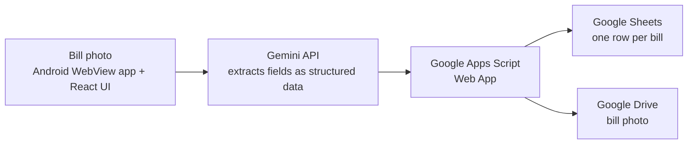

# BillVault - AI Bill Scanner (Android)

Android app that reads household bills with AI. Take a photo of an electricity, property tax, water or LIC premium bill; the Gemini API extracts the fields, and the data plus the bill photo are saved automatically to Google Sheets and Google Drive. No manual data entry.

The app is built from a Google Colab notebook (`billvault.ipynb`).

## How it works

More detail and design trade-offs: [docs/architecture.md](docs/architecture.md)

## Tech stack

- Android WebView app (Java) + React UI
- Google Gemini API (automatic model discovery)
- Google Apps Script (Sheets + Drive backend, no server to host)
- Google Colab (builds the APK)

## Setup

1. Get a free Gemini API key from aistudio.google.com and paste it in Cell 1 (do not commit it).
2. Create a Google Sheet, then deploy the Apps Script (shown in the app's Settings) as a Web App.
3. Put your own Sheet ID in the script and your Web App URL in the HTML (`SHEET_URL`).
4. Run Cells 1 to 5 in order to build and download the APK.

## Privacy and security

- Bills contain personal data (names, addresses, account numbers). Data goes only to your own Google account; nothing personal is stored in this repository.
- Never commit your API key, Sheet ID or Web App URL. The notebook in this repo has its outputs cleared for that reason.
- Treat the Web App URL like a secret: if the script is deployed so that anyone with the link can call it, anyone who finds the link can write to your sheet.
- Restrict your Gemini API key in Google AI Studio / Cloud Console and rotate it if it is ever exposed.
- Bill photos are sent to the Gemini API for extraction; review Google's terms before scanning sensitive documents.

## Limitations and next steps

- The app is generated from a single notebook, which makes code review and versioning harder than a normal Android project.
- No automated tests yet, and extraction accuracy has not been measured on a labelled set of bills.
- Free-tier Gemini rate limits can slow batch scanning.
- No APK release is published yet.
- Next: split the app into proper Android and React source folders, add a validation step for extracted fields (dates, amounts), add redacted screenshots, and publish a signed APK as a GitHub release.
